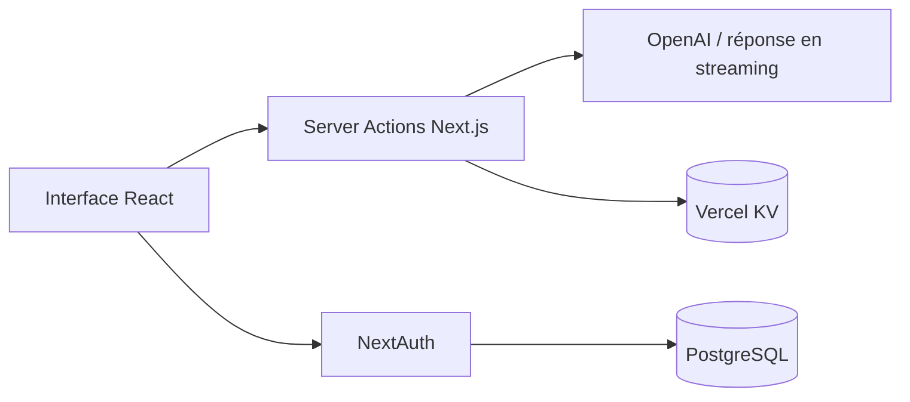

# INNOFLEX Conversational AI

Assistant conversationnel construit avec Next.js et le Vercel AI SDK. Le dépôt explore aussi des interfaces de données de marché et des intégrations d’avatar sur une branche de développement dédiée.

[Voir la démonstration](https://innoflex-conversational-ai.vercel.app) · [Documentation du template d’origine](docs/UPSTREAM-README.md)

## Fonctionnalités et périmètre

| Branche | Contenu |
| --- | --- |
| `main` | Chat IA en streaming, authentification, historique et partage de conversations ; base de la démonstration de production |
| [`cryptocurrency`](https://github.com/ddesilias/innoflex-conversational-ai/tree/cryptocurrency) | Développement des pages de marché, actualités et avatar ; page de journal encore à l’état d’ébauche |

Le journal de trading n’est pas une fonctionnalité achevée. La disponibilité du chat et des intégrations dépend des services et des clés configurés.

## Architecture

Next.js 14 et React Server Components composent l’interface. Les Server Actions transmettent les messages au modèle OpenAI via le Vercel AI SDK. NextAuth gère les sessions ; PostgreSQL et Vercel KV assurent les besoins de persistance présents dans le code.



## Démarrage local

```bash
git clone https://github.com/ddesilias/innoflex-conversational-ai.git
cd innoflex-conversational-ai
pnpm install
pnpm dev
```

Configurer un fichier `.env.local` privé avant de lancer les services concernés :

| Variable | Usage |
| --- | --- |
| `AUTH_SECRET` | Secret serveur utilisé par NextAuth |
| `OPENAI_API_KEY` | Appels au modèle OpenAI |
| `DATABASE_URL` | Connexion PostgreSQL |
| `KV_URL`, `KV_REST_API_URL`, `KV_REST_API_TOKEN`, `KV_REST_API_READ_ONLY_TOKEN` | Stockage et accès KV |
| `NEXT_PUBLIC_X_CG_DEMO_API_KEY` | Accès CoinGecko sur `cryptocurrency` ; variable exposée au navigateur |

Créer un secret aléatoire propre à chaque environnement. Les clés serveur restent dans les variables d’environnement et ne doivent pas être commitées. Les intégrations supplémentaires de `cryptocurrency` demandent leur propre configuration.

## Repères dans le code

- `lib/chat/actions.tsx` : orchestration du chat et streaming.
- `auth.config.ts` et `auth.ts` : configuration des sessions et connexion.
- `app/(chat)` : interface et routes des conversations.
- `lib/coin-gecko-api` sur `cryptocurrency` : récupération et validation des données de marché.

## Validation et limites

La vérification TypeScript de la branche de développement passe. Le contrôle de présentation porte sur les pages publiques ; aucun compte n’a été créé et aucun appel IA payant n’a été déclenché pour cette vérification. La connexion avec un compte réel et le parcours complet de conversation restent à valider.

## Origine du projet

Ce dépôt adapte le template **AI Chatbot de Vercel**. Les crédits et la documentation antérieure sont conservés dans [docs/UPSTREAM-README.md](docs/UPSTREAM-README.md), avec la [licence du dépôt](LICENSE). Les fonctionnalités héritées du template font partie de cette base ; elles ne sont pas présentées comme une création intégrale originale.
